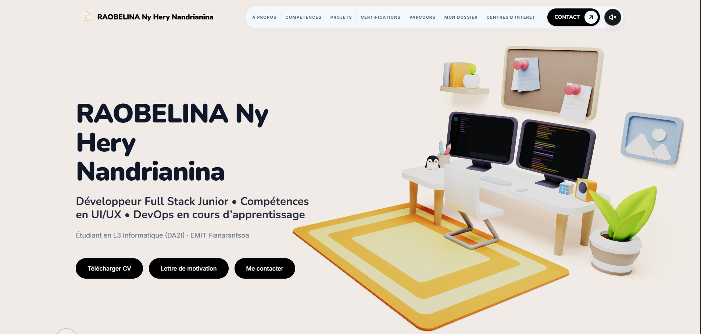

<!-- HEADER : PORTFOLIO -->

  <h2>MON PORTFOLIO</h2>

  

   

  

---

<!-- ANIMATION DE PRÉSENTATION -->
<h2 align="center">
  
</h2>

---

## Activité GitHub

  

---

## Langages de programmation et outils

  

---

## À propos

  Développeur Web et Mobile Junior passionné 
  Développement mobile avec Flutter et Dart 
  Développement Backend avec Java et Spring Boot 
  Cybersécurité et développement Web 
  Apprentissage continu et progression constante

---

## AI System Dashboard — GitHub

  <h3>À PROPOS</h3>

  

   

  

---

## Mes chaînes Dev préférées

  

  
  
  
  
  
  

  <a href="https://www.youtube.com/watch_videos?video_ids=NRxzvpdduvQ,Gt7Gu0Hqppk,sWbUDq4S6Y8,LAKBrQ-b4kI,DYHCG6G5R_k,Rt7xwb1SOcY">
    ▶️ Regarder les six vidéos sur YouTube
  </a>

---

<!-- SÉPARATEUR -->

  

<!-- FOOTER -->

  

